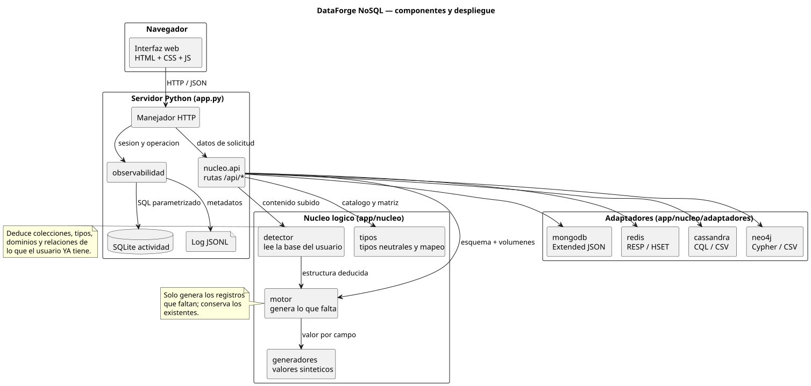
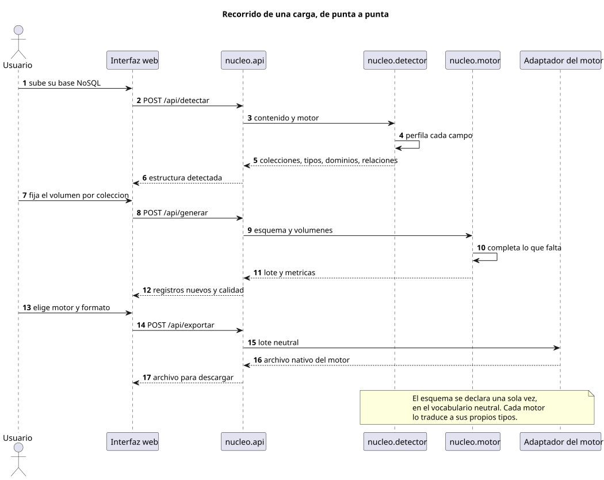

# Manual tecnico — DataForge NoSQL

**Grupo 14** · SI-783 Base de Datos II · 2026-II

Rodriguez Cardenas, Patrick (2022075751) · Rios Cohaila, Nicole Luciana (2022075745)

---

## 1. Que hace

DataForge NoSQL lee una base de datos NoSQL **incompleta** y genera los
registros que le faltan para completarla, respetando su estructura.

El usuario no declara un esquema: sube lo que ya tiene y la aplicacion
deduce colecciones, campos, tipos, dominios y relaciones de la propia
muestra. Con esa estructura genera los datos que faltan y los exporta en
el formato nativo de cuatro motores.

## 2. Arquitectura

El nucleo es Python de biblioteca estandar: no hay dependencias que
instalar, y por eso el mismo codigo corre en local y en el servicio
publico. La interfaz es una pagina estatica que consume la API.

```
app.py                     servidor HTTP (solo biblioteca estandar)
app/nucleo/
  tipos.py                 los 23 tipos neutrales y su mapeo a cada motor
  generadores.py           catalogo de valores sinteticos
  detector.py              lee la base del usuario y deduce su estructura
  motor.py                 completa lo que falta y mide la calidad
  adaptadores/             un modulo por motor (mongodb, redis, cassandra, neo4j)
  api.py                   las rutas que consume el navegador
app/web/                   interfaz (HTML + CSS + JS, sin framework)
```



## 3. Por que un vocabulario neutral

Los cuatro motores no comparten ni el modelo de datos ni los tipos.
MongoDB habla de ObjectId y Decimal128; Redis no tiene tipos (todo es una
cadena); Cassandra tiene `uuid` y `bigint`; Neo4j tiene `Point` y guarda
los decimales como coma flotante.

Si el esquema se declarara en el vocabulario de un motor, los otros tres
serian traducciones de una traduccion. Por eso el proyecto define un
**vocabulario neutral** y cada adaptador traduce desde ahi: es lo que
permite que un mismo esquema produzca los cuatro formatos sin tocarlo.

La traduccion completa, con los tipos que cada motor tiene que aproximar,
esta en [`matriz-tipos.md`](matriz-tipos.md).

## 4. El recorrido de una carga



1. **Detectar.** El detector perfila cada campo de la muestra: tipo
   observado, valores distintos, nulos, rango numerico y ejemplos. De ese
   perfil deduce el tipo neutral, si el campo es un dominio cerrado, si es
   clave y si apunta a otra coleccion.
2. **Generar.** El motor completa cada coleccion hasta el volumen pedido,
   conservando los registros que ya existian. Respeta claves, unicidad,
   dominios y relaciones.
3. **Exportar.** El adaptador del motor elegido traduce el lote a su
   formato nativo.

## 5. Decisiones de diseno

**El texto generado no se recorta al largo observado.** El largo de la
muestra no es un limite del campo: un `numero` observado como `P-1` mide
tres caracteres, pero eso no autoriza a truncar `COD-45283` a `COD`.

**El correo se deriva del nombre de la misma fila.** Sin esto el
generador produce datos que existen pero se contradicen: un nombre de una
persona con el correo de otra.

**Un dominio cerrado se reconoce por repeticion o por el nombre.** Un
`estado` con dos valores repetidos es un dominio; un `sku` con ocho
valores todos distintos es un identificador, aunque la muestra sea
pequena. El nombre del campo desempata cuando la muestra no basta.

**La misma semilla produce el mismo lote.** Un error reportado se puede
reproducir, que es lo que hace util el determinismo en una herramienta de
pruebas.

**Los ejemplos pasan por el mismo detector que un archivo del usuario.**
No hay un camino especial para ellos: si el detector se rompe, los
ejemplos tambien fallan y la prueba lo detecta.

## 6. Uso

```bash
python3 app.py                      # http://127.0.0.1:8000
python3 app/tests/casos.py          # la suite del nucleo
python3 doc/generar_documentos.py   # regenera esta documentacion
```

## 7. Estado verificado

Con la semilla 2026 y 40 registros por coleccion, el ejemplo
`tienda_mongodb` produce **120 registros** en
3 colecciones, con
**100.0 % de completitud** y
3/3 columnas unicas respetadas, sin ninguna relacion huerfana.

## 8. Limitaciones declaradas

- El detector trabaja sobre una **muestra** (hasta 2000 registros por
  coleccion). Una estructura que solo aparezca mas alla de esa muestra no
  se detecta.
- El lote es **sintetico**: los valores son plausibles, no reales. No
  sustituyen a una copia de produccion anonimizada.
- La deteccion de relaciones por valores exige que la clave destino
  aparezca entre los ejemplos observados; con muestras muy pequenas puede
  no deducirse una relacion. El nombre del campo es el respaldo.

---

Documentacion generada desde el codigo con `doc/generar_documentos.py`.
